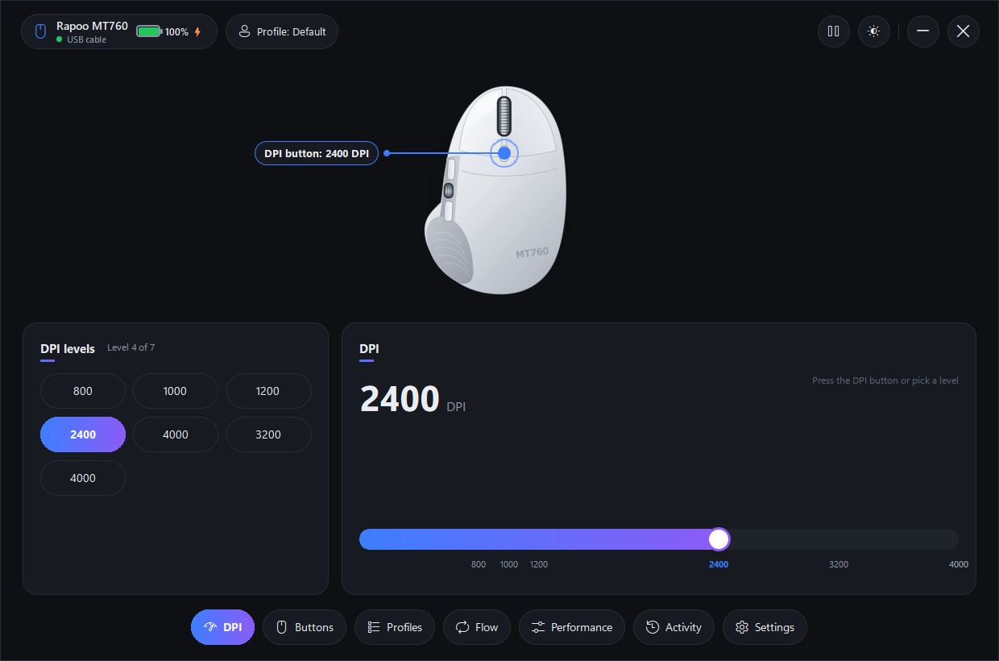
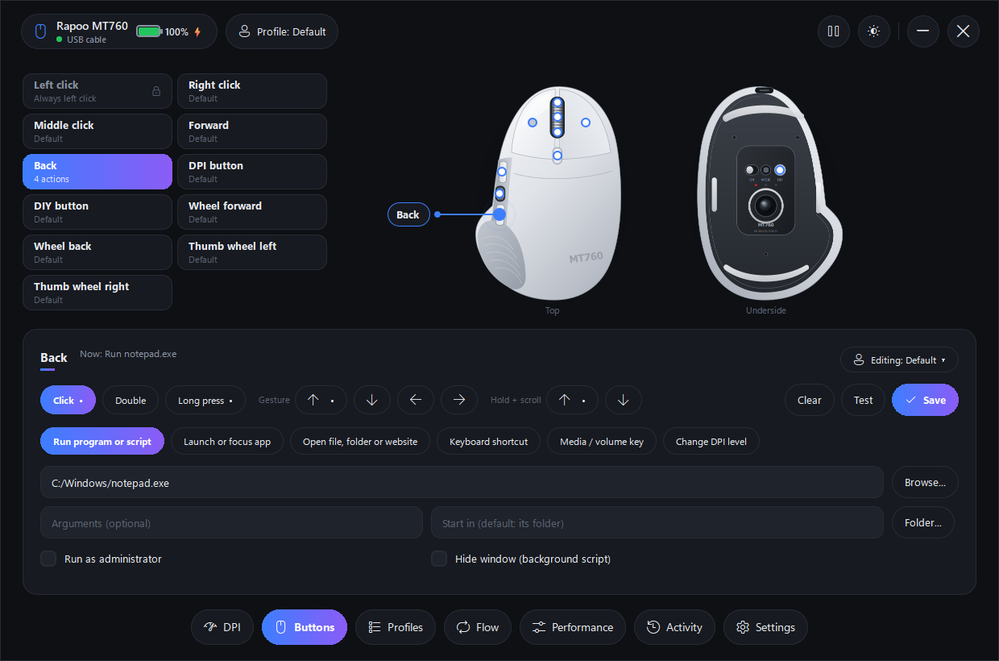
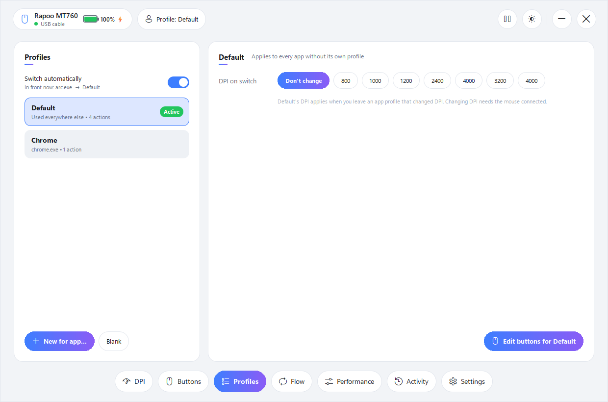
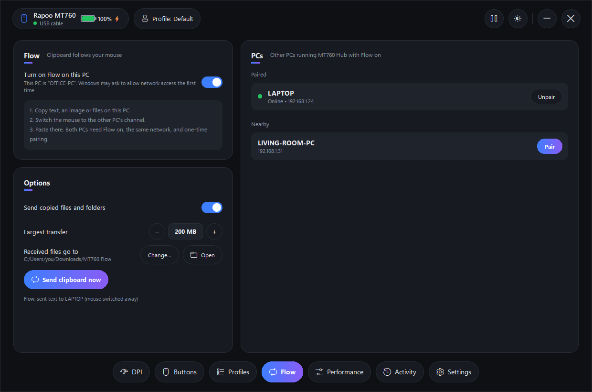
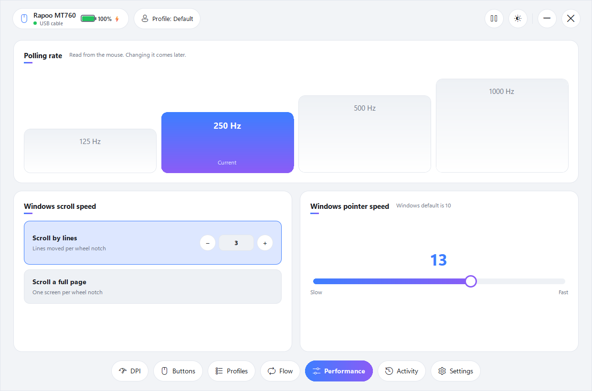
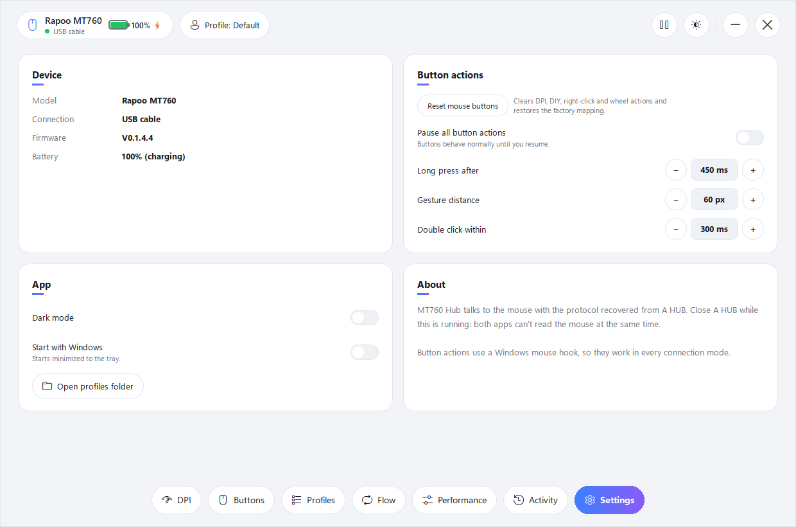

# Rapoo HUB Plus

An unofficial replacement for Rapoo's A HUB software for the **Rapoo MT760** mouse, with
features A HUB doesn't have: programs and scripts on any button, gestures, per-app profiles and a
clipboard that follows the mouse between PCs.

Windows only. Not affiliated with or endorsed by Rapoo.

## Screenshots

| DPI | Buttons |
|---|---|
|  |  |
| **Profiles** | **Flow** |
|  |  |
| **Performance** | **Settings** |
|  |  |

## Features

- **DPI**: see and switch DPI levels live as you press the DPI button.
- **Buttons**: run a program or script (`.exe`, `.bat`, `.ps1`, `.py`, `.sh`), launch or focus an
  app, open a file, folder or website, send a keyboard shortcut, media keys or change DPI.
  - Triggers: click, double click, long press, hold + move (gestures), hold + scroll.
  - Right click, the DPI button, the DIY button and the scroll wheel are remapped on the mouse
    itself to spare keys (F13-F17) that the app catches. Left click is never remapped.
- **Profiles**: per-app profiles that switch automatically with the app in front, each with its
  own button actions and DPI level. Anything a profile doesn't set comes from Default.
- **Flow**: copy on one PC, switch the mouse to the other PC's Bluetooth channel, paste there.
  - Carries text, images and files.
  - Sent over the local network, end-to-end encrypted, after a one-time pairing with a 6-digit
    code compared on both PCs.
- **Performance**: polling rate, plus Windows scroll lines and pointer speed.
- Battery, firmware version, tray icon, start with Windows, dark and light themes.

## Connection modes

| | USB cable | 2.4 GHz receiver | Bluetooth |
|---|---|---|---|
| Button actions, gestures, profiles, Flow | yes | yes | yes |
| Read DPI, polling rate, battery, firmware | yes | yes | yes |
| Change DPI, store button remaps | yes | yes | no (the mouse accepts settings changes only over cable or receiver) |

## Run

Requires Python 3.11+ on Windows.

```
pip install -r requirements.txt
python main.py
```

Add `--tray` to start minimized to the tray. Close Rapoo's A HUB first; both apps can't talk to
the mouse at the same time.

Settings and profiles are stored in `%APPDATA%\MT760Hub`.

## Layout

| File | Purpose |
|---|---|
| `main.py` | App start: QML window, tray, hooks |
| `device.py` | Mouse protocol over cable, receiver and Bluetooth |
| `blegatt.py` | Win32 Bluetooth LE GATT access |
| `keymap.py` | The mouse's button table (firmware remapping) |
| `hook.py` | Low-level mouse and keyboard hooks: clicks, gestures, hold + scroll |
| `actions.py` | What a button does |
| `config.py` | Profiles and settings |
| `backend.py` | Bridge between the UI and the device |
| `flow.py`, `flow_core.py` | Flow clipboard sync |
| `qml/` | Interface |

## Disclaimer

The mouse protocol was worked out by observing how Rapoo's own software talks to the mouse. Writing
settings to the mouse is at your own risk. "Rapoo" and "MT760" are trademarks of their owner.
